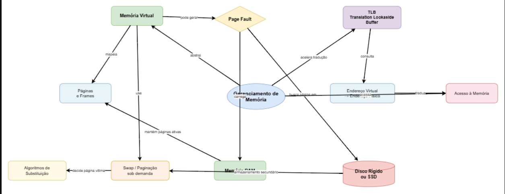

# Sistema-Operacional---Gerenciamento-de-Mem-ria

Felipe Piva 25054343-2
Nicollas Azalim Prado 25013758-2

# O Fenômeno da Paginação e o Gargalo do Disco
falta de páginas é quando um programa tentar usar uma página que não está mapeada e é gerada uma interrupção da CPU para o sistema operacional a fim de buscar está página na memória. As ações desencadeadas são: o sistema operacional escolhe uma moldura de página pouco usada para salvar no disco. Em seguida, a página virtual referencia pela instrução na moldura de página que foi liberada. Quando ocorre a falta de páginas, o SO precisa salvar uma página no disco rígido(memória secundária) e buscar uma página solicitada. Enquanto o disco trabalha, o processo que causou a falta de página é colocado em estado de espera, deixando a CPU ociosa até que a página chegue na memória principal.

# O Papel e a Eficiência da TLB
O TLB é uma memória pequena e rápida que armazena os mapeamentos usados mais recentemente de endereços lógicos para físicos. Ele geralmente está localizado dentro ou perto da CPU, para que possa ser acessado rapidamente. O TLB atua como um atalho para a conversão de endereços, evitando a necessidade de consultar a tabela de páginas, que é uma estrutura de dados que armazena o mapeamento completo da memória virtual. A tabela de páginas é geralmente armazenada na memória principal ou no disco, que são muito mais lentos do que o TLB.  Antes de consultar a tabela de páginas, a MMU verifica primeiro o Translation Lookaside Buffer (TLB) para a tradução solicitada. O TLB funciona como um cache de alta velocidade que armazena mapeamentos de endereços virtuais para físicos usados ​​recentemente. Se o TLB contiver a tradução necessária (um acerto no TLB), a MMU poderá fornecer imediatamente o endereço físico sem acessar a tabela de páginas mais lenta na memória principal. Esse acerto de cache reduz significativamente a latência de acesso à memória e melhora o desempenho geral do sistema. Quando o TLB não contém a tradução necessária (uma falha no TLB), a MMU deve realizar uma busca na tabela de páginas para encontrar o mapeamento correto. Após recuperar a tradução da tabela de páginas, a MMU atualiza o TLB com essa nova entrada para uso futuro.
 A TLB (Translation Lookaside Buffer) é uma memória cache de alta velocidade que armazena traduções recentes de endereços virtuais para endereços físicos. Sua finalidade é acelerar o acesso à memória, evitando que o processador precise consultar a tabela de páginas na memória principal a cada acesso. Quando ocorre um TLB hit, significa que a tradução do endereço procurado já está armazenada na TLB, permitindo que o processador obtenha rapidamente o endereço físico correspondente. Por outro lado, quando ocorre um TLB miss, essa tradução não está disponível na TLB, sendo necessário consultar a tabela de páginas para localizar o mapeamento correto. Esse procedimento acrescenta acessos à memória e ciclos de processamento.  Em um servidor de banco de dados, uma alta taxa de TLB miss pode prejudicar o desempenho porque o processador precisa realizar essas consultas adicionais com maior frequência. Como consequência, o acesso aos dados se torna mais lento, o tempo de processamento das consultas pode aumentar e as respostas às solicitações dos usuários podem demorar mais. Além disso, quando um processo acessa páginas de memória diferentes com frequência, a probabilidade de ocorrerem novos TLB misses aumenta. Portanto, manter na TLB as traduções mais úteis para os acessos realizados contribui para melhorar o desempenho do sistema. Quando o Sistema Operacional realiza uma troca de contexto entre processos, o conteúdo da TLB precisa ser tratado com cuidado, pois cada processo pode possuir seu próprio espaço de endereçamento virtual. Isso significa que um mesmo endereço virtual pode corresponder a endereços físicos diferentes dependendo do processo que está sendo executado. No modelo apresentado pelo livro, a TLB é esvaziada durante a troca entre processos para evitar que o novo processo utilize traduções de endereços pertencentes ao processo anterior. Após essa limpeza, as traduções necessárias precisam ser consultadas novamente na tabela de páginas e podem ser armazenadas na TLB conforme o processo acessa a memória.  Esse procedimento pode provocar uma queda temporária de desempenho após a troca de contexto, porque o novo processo começa com menos traduções disponíveis na TLB. Se ocorrerem muitos TLB misses, o processador precisará realizar consultas adicionais à tabela de páginas, aumentando o custo dos acessos à memória e podendo elevar o tempo de resposta das operações do banco de dados. É importante observar que a limpeza da TLB descrita aqui corresponde ao modelo simplificado apresentado no material. Em processadores modernos, o comportamento pode variar conforme a arquitetura e os mecanismos utilizados pelo Sistema Operacional.

# Síntese e Solução
Se a organização optar por duplicar a capacidade da memória RAM física do servidor, o cenário operacional sofrerá uma reviravolta expressiva, sanando o gargalo de desempenho. Ao expandir o espaço disponível na memória principal, o sistema passa a ter capacidade suficiente para acomodar integralmente o conjunto de trabalho (working set) das aplicações e do banco de dados, eliminando a escassez crônica de molduras de páginas que provocava o colapso anterior. Com essa folga de hardware, o volume de interrupções por falta de página despenca vertiginosamente, pois o gerenciador de memória do sistema operacional raramente precisará expulsar páginas ativas para a memória secundária. Consequentemente, o disco rígido é aliviado de suas operações frenéticas de E/S de swap, cessando a sobrecarga de cem por cento de utilização. Desse modo, os processos deixam de ficar travados em estado de espera aguardando o resgate de dados no disco, permitindo que a CPU recupere sua utilidade plena e deixe de ficar ociosa, restabelecendo a performance e a eficiência de processamento do servidor de e-commerce.

# Referências
MAZIERO, Carlos Alberto. Sistemas operacionais: conceitos e mecanismos. Curitiba: DINF/UFPR, 2019. Capítulo 14, especialmente páginas 177–184.
WHAT ROLE does TLB play in virtual memory management? LinkedIn. [S. l.], [s. d.]. Disponível em: https://www.linkedin.com/advice/0/what-role-tlb-virtual-memory-management-skills-operating-systems-t9syc?lang=pt. Acesso em: 15 out. 2026.
LAINE, Jean M. Sistemas operacionais: aula 14 – memória virtual. [S. l.: s. n.], [s. d.]. Material didático em PDF.

# Link para o acesso dos vídeos
https://youtu.be/4EaBN98dk40?si=jdUqfM36-4TrglQe
https://youtu.be/ZUe8Jp8H4RE?si=pXyf5W2cYWWVWWFb

# Audio ou Podcast: https://open.spotify.com/show/4zeQUtMZUv7e9AwK8giLTA

# Livros ou artigos: https://wiki.inf.ufpr.br/maziero/lib/exe/fetch.php?media=socm:socm-livro.pdf
https://professor.pucgoias.edu.br/SiteDocente/admin/arquivosUpload/17785/material/AULA%2014%20-%20Memria%20Virtual.pdf

